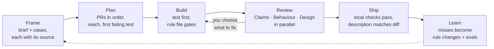

# Groundwork

A skill that takes a code change from a request to a reviewed pull request. It holds the judgement a
careful reviewer asks for, written as rules an agent can follow and check.

Three ideas set it apart:

- **Evidence, not guesses.** Every claim names what it rests on: code read to its call chain, a
  grep, a count from real data, a vendor's own docs. What cannot be checked is called unverified.
- **Ranked sources.** Where the repo's rules, the ticket, the repo's habits and the agent's own
  taste disagree, a fixed order says which wins, and every finding names its rank.
- **Product decisions belong to people.** The agent never invents what a feature should do. It
  quotes the ticket or the design, or asks you, with options and a recommendation.

The code standard is organised by the code-review defect types of
[Mäntylä and Lassenius (2009)](https://doi.org/10.1109/TSE.2008.71), as refined by
[Beller et al. (2014)](https://doi.org/10.1145/2597073.2597082): one file per defect category, each
with rules and most with a gate, the thing the agent produces before it moves on.

## The flow



| step | produces |
|---|---|
| Frame | A brief: the problem, the behaviour as concrete cases, what is out of scope, each with its source. Open product questions put to you. |
| Plan | The PRs, in order. For each: its cases, its files, the test that fails first, what it leaves for later. |
| Build | Code and tests, each rule file's gate met, the repo's checks run and reported. |
| Review | Three reviewers, each with its own question and its own rule files, reporting `file:line`, the fix, and the evidence with its rank. |
| Ship | A PR description that matches the diff. Nothing is pushed or posted without your go-ahead. |
| Learn | After people review the PR: each comment the skill missed, and each finding you rejected, becomes a proposed rule change and an eval scenario. Applied only if you agree. |

A small change (one behaviour, no new public name, schema, setting or product rule) starts at Build.

## Install

Groundwork is one [Agent Skill](https://agentskills.io): a `SKILL.md` with plain Markdown beside it.
Any agent that loads `SKILL.md` skills can run it. The repo also ships native plugin manifests, in
the formats other multi-agent plugins use; only the Claude Code install has been tested here.

| agent | install |
|---|---|
| Claude Code | `claude plugin marketplace add arcatva/groundwork`, then `claude plugin install groundwork@groundwork` |
| GitHub Copilot CLI | `copilot plugin marketplace add arcatva/groundwork`, then `copilot plugin install groundwork@groundwork` |
| Codex | `codex plugin marketplace add arcatva/groundwork`, then install `groundwork` from `/plugins` |
| Cursor | the plugin manifests are in `.cursor-plugin/`; add the repo as a plugin source |
| Kimi Code | `/plugins install https://github.com/arcatva/groundwork` |
| Devin CLI | `devin plugins install arcatva/groundwork` |
| Grok CLI | `grok plugin install arcatva/groundwork` |
| Any other agent | `git clone https://github.com/arcatva/groundwork && groundwork/scripts/install-skills.sh <your agent's skills dir>` |

An agent with no skill support at all can still follow it: point its instruction file
(`AGENTS.md`, `GEMINI.md` or the like) at `skills/groundwork/SKILL.md`.

The skill names no agent's tools. Where it says to run reviewers in parallel, an agent that cannot
start subagents runs them one after another.

## Use

- "Build the retry window described in issue 42": starts at Frame.
- "Plan how to split this brief into PRs": starts at Plan.
- "Review PR 128": runs the review at that PR's head.

The skill works with whatever the session can reach: a code host CLI (`gh`, `glab`), an issue
tracker, a design tool, a team wiki, chat history. None is required. Where a source is out of
reach, the agent says so and asks.

## What you see

Each step ends with one short report: where the work stands, its output as a table or list, and
the next thing you must answer. Questions come with options shown on concrete values and a
recommendation. Every report is also appended to `.groundwork/log.md` in your repo, which git is
told to ignore, so a later session can pick up where work stopped and trace why a choice was made.

## Safety

Nothing outward-facing happens without your go-ahead: no push, no PR, no comment, no merge. The
review is read-only towards the code host and changes no file. Checking out someone else's PR installs its dependencies, so the agent asks
first.

## Layout

```
skills/groundwork/SKILL.md     the three principles, the flow, the rule file index
skills/groundwork/flow/        frame, plan, build, ship, learn
skills/groundwork/review.md    the three reviewers and the brief they share
skills/groundwork/contracts.md the shape of every hand-off: to the next step, a reviewer, you, the log
skills/groundwork/standard/    evolvability/, functional/: one file per defect category
skills/groundwork/index.json   the flow, reviewers and rule index; tables and schemas are generated from it
skills/groundwork/schemas/     JSON Schemas of the reviewer report, the run log entry and the index
cmd/groundwork/, internal/     the `groundwork` command: lint, eval, compare (Go, standard library only)
evals/scenarios/, fixture/     eval scenarios and the small repo they run on
scripts/install-skills.sh      link or copy the skill into any agent's skills directory
.*-plugin/, .agents/           plugin manifests for each agent, kept in step by lint
```

The skill is markdown only: using it needs nothing else. The command is for changing the skill and
measuring it.

## Changing it

```sh
go test ./...                    # unit tests, and the repo's own rules
go run ./cmd/groundwork lint     # the same rules, as CI runs them
go run ./cmd/groundwork gen      # rewrite the generated tables and schemas after editing index.json
```

Lint fails when a rule file has no reviewer or no index entry, a pointer names a file that does not
exist, the flow or the review states a rule of its own instead of pointing at `standard/`, the
skill passes its word budget, a vendor is named in the skill, a merge request is called anything
but a PR, the manifests disagree, or a scenario breaks its contract. Each check has a test that
breaks the rule once and expects the check to catch it. To keep particular words out of every
tracked file, list them one per line in an untracked `.neutral-words` file. See
[CONTRIBUTING.md](CONTRIBUTING.md).

## Evals

`go run ./cmd/groundwork eval` runs each scenario in `evals/scenarios/` as headless Claude Code on
a fresh copy of `evals/fixture/` (or any other agent CLI, with `--agent-cmd 'your-agent {prompt}'`),
then has a grader score the run against the scenario's rubric. Add `--baseline` to run the same
prompts without the plugin. Each scenario checks behaviour the skill
promises: asking instead of inventing a product rule, test first on a small bug, finding planted
defects in a review. A rule change comes with a scenario that shows it, and its score before and
after.

The agent under test edits files without asking, and runs its shell in Claude Code's sandbox: no
network, and writes only inside its work tree and the sandbox's temp folder (`internal/sandbox`). A
run that cannot get the sandbox fails rather than running without it. Runs go one at a time, since
the sandbox gives them one temp folder; a lock turns a second harness run away.

Results of round 7 (2026-10-30), Claude Code, one run each. A run varies, so a gap of a point or
two is noise. "Outcomes" leaves out the criteria only the skill's own process can meet (its log, its
three reviewers), so it compares like with like.

| scenario | what it checks | with groundwork: all / outcomes | without: all / outcomes |
|---|---|---|---|
| ambiguous-feature | asks for the limit, the day boundary and admins instead of inventing them | 8/9 · 7/8 | 1/9 · 1/8 |
| small-bug | test first, seen failing, full suite run, nothing unasked added | 9/9 · 8/8 | 7/9 · 7/8 |
| review-planted | six planted defects, each finding located | 11/11 · 8/8 | 7/11 · 7/8 |
| review-repo-rule | a repo rule and a description claim the diff breaks | 7/7 · 5/5 | 5/7 · 5/5 |
| review-scope | edits the PR's purpose does not need | 4/4 · 4/4 | 3/4 · 3/4 |
| total | | 39/40 · 32/33 | 23/40 · 23/33 |

The review scenarios barely separate the runs: a strong model already finds planted bugs. The gap
is in how the work is done: asking instead of deciding, and test first. groundwork's one fail this
round was a question about a number it would not recommend; it passed in rounds 4 to 6. The history
of every round is in [docs/evolution.md](docs/evolution.md).

## Comparison with other review skills

`go run ./cmd/groundwork compare` replays public pull requests at the commit their first human review
saw, runs each review skill on them in the same sandbox, and grades every report blind against the
points the human reviewers made. Results are in [docs/comparison.md](docs/comparison.md) once a run is
published.

## License

MIT
